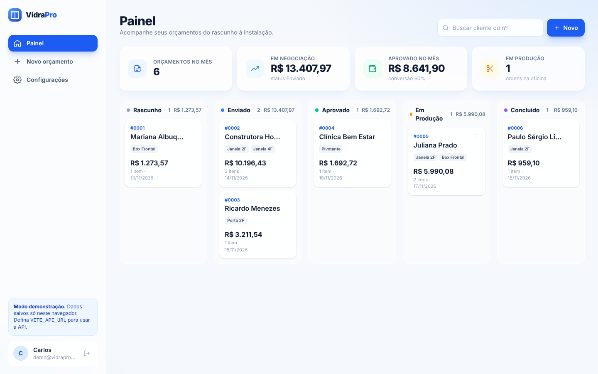

# VidraPro — SaaS de orçamentos para vidraçarias e serralherias de alumínio

**🔗 Demo ao vivo:** https://leohamil31.github.io/VIDRAPRO/ (modo demonstração — dados salvos só no seu navegador; clique em *Entrar*)



MVP multi-tenant: medidas do vão → **preço para o cliente** + **lista de corte para a oficina** + **PDF com a logo** + **envio por WhatsApp** + **kanban de pedidos**.

```
vidrapro/
├── database/schema.sql          PostgreSQL / Supabase: tabelas, RLS, triggers, função pública, seed de preços
├── packages/engine/             Motor de cálculo (TypeScript puro, zero dependências, browser + Node)
│   ├── src/catalog.ts           Tipologias, perfis (kg/m), vidros, parâmetros de desconto
│   ├── src/cutting/             OFICINA: deduções → perfis, vidros, kits, otimização de barras 6 m
│   ├── src/pricing/             CLIENTE: BOM + tabela de preços → custo, markup, totais
│   ├── src/quote.ts             Junta os dois + mensagem WhatsApp / link wa.me
│   └── test/engine.test.js      11 testes (node --test)
├── backend/                     Express + TypeScript + pg + zod
│   └── src/{server,db,env}.ts, middleware/{auth,subscription}.ts, routes/{auth,settings,quotes,public,webhooks}.ts
└── frontend/                    React 19 + Tailwind v4 (Vite)
    └── src/pages/{Dashboard,QuoteBuilder,QuoteView,CuttingListPage,Settings,Login}.tsx
        src/components/schematic/Schematic.tsx   desenho técnico SVG em escala
        src/lib/demo.ts                          backend offline (localStorage) para demonstrações
```

## Rodando

```bash
npm install
npm test                                   # testes do motor

# Banco (Postgres local ou Supabase SQL editor)
psql "$DATABASE_URL_ADMIN" -f database/schema.sql
# troque a senha do role app_api: ALTER ROLE app_api PASSWORD '...';

cp backend/.env.example backend/.env       # ajuste as URLs/segredos
cp frontend/.env.example frontend/.env
npm run dev:api                            # http://localhost:4000
npm run dev:web                            # http://localhost:5173
```

Sem `VITE_API_URL` o frontend roda em **modo demonstração** (dados de exemplo no navegador) — útil para mostrar a clientes.

## Isolamento multi-tenant (defesa em camadas)

1. Toda tabela de negócio tem `tenant_id NOT NULL`.
2. **RLS forçado** em todas elas, com política `tenant_id = current_tenant_id()`.
3. A API roda como role `app_api` (**sem BYPASSRLS**) e cada request acontece dentro de `withTenant()`, que faz `set_config('app.tenant_id', …, true)` local à transação. Se alguém esquecer um `WHERE tenant_id`, o banco bloqueia mesmo assim.
4. Com Supabase direto no cliente, `current_tenant_id()` resolve pelo `auth.uid()`.
5. Colunas de assinatura (`subscription_status` etc.) **não têm GRANT de UPDATE** para o tenant — só o webhook (service role) altera.
6. Trigger impede `quote_items` apontando para orçamento de outro tenant.
7. Link público usa `public_quote(token)` (SECURITY DEFINER) que devolve **só** campos para o cliente — nunca custo, margem ou lista de corte. Rascunhos não são públicos.

Testado em Postgres 16: inserção cruzada bloqueada por RLS, edição de assinatura negada, sem tenant = 0 linhas, numeração por tenant (#1, #2… independente).

## Motor de cálculo

**Separação deliberada:** `cutting/` não conhece dinheiro; `pricing/` não conhece fórmulas. A oficina pode mudar uma dedução sem mexer em preço, e o comercial muda preço sem risco para o corte.

| Tipologia | Regra principal |
|---|---|
| Janela correr 2F (Suprema) | folha = (L − 2·10 + 50) ÷ 2 · altura folha = H − 45 · marco lateral = H − 32 |
| Janela correr 4F (Suprema) | folha = (L − 20 + 2·50 + 20) ÷ 4 |
| Porta correr 2F (Suprema/Gold) | parâmetros e perfis próprios por linha; alerta de peso por folha |
| Box frontal 8mm | ≤ 1400 mm: 1 fixo + 1 móvel; acima: 2 fixos + 2 móveis · painel = (L + N/2·50) ÷ N · fixo H − 15, móvel H − 35 |
| Pivotante 8/10mm | vidro (L − 8) × (H − 15) · alerta acima de 80 kg |

Preço: alumínio = Σ(comprimento × kg/m) × (1 + perda%) × R$/kg do acabamento · vidro = cada lado arredondado para cima (padrão 5 cm), área mínima por peça · kits por tipologia · `preço = custo × (1 + margem%)` (markup). Preço ausente é sinalizado e bloqueia o salvamento no servidor.

> ⚠️ **Valide antes de produzir.** Códigos de perfil, pesos (kg/m) e descontos em `catalog.ts` são **valores de referência**, não de um catálogo específico. Confira com a sua extrusora (linha Suprema/Gold do seu fornecedor) e ajuste `SLIDING_PARAMS`, `BOX_PARAMS`, `PIVOT_PARAMS` e `PROFILES`. Os testes servem de rede de segurança ao alterar.

O frontend roda o motor localmente para a **prévia ao vivo**; ao salvar, o **servidor recalcula** com a tabela de preços do banco (o cliente nunca é confiável) e grava um *snapshot* (`price_breakdown`, `cutting_list`, `engine_version`) — orçamentos antigos não mudam quando preços ou fórmulas mudam.

## API

| Método | Rota | |
|---|---|---|
| POST | `/auth/signup`, `/auth/login` | modo local (scrypt + JWT) |
| POST | `/auth/onboard` | modo Supabase Auth: cria a empresa do usuário |
| GET/PUT | `/settings`, `/settings/prices` · POST `/settings/logo` | logo → Supabase Storage |
| GET | `/quotes`, `/quotes/stats`, `/quotes/pricing-context` | |
| POST | `/quotes/preview` | cálculo sem salvar |
| POST/GET/PUT/DELETE | `/quotes`, `/quotes/:id` | edição só em Rascunho/Enviado |
| PATCH | `/quotes/:id/status` | kanban (oficina só move para Produção/Concluído) |
| GET | `/quotes/:id/cutting-list` | lista consolidada + barras de 6 m por acabamento |
| POST | `/quotes/:id/share` | marca Enviado, devolve link `wa.me` + URL pública |
| GET | `/public/quotes/:token` | página do cliente final (rate limited) |
| POST | `/webhooks/billing` | HMAC `X-Signature: sha256=…`, idempotente por `id` |

**Assinatura:** `trial`/`active` = acesso total. `past_due`, `canceled` ou trial vencido = **somente leitura** (escritas retornam 402). O status vai no header `X-Subscription-Status` e o frontend mostra um banner. O webhook recebe um evento normalizado (`subscription.activated`, `invoice.paid`, `invoice.payment_failed`, `subscription.canceled`) — escreva um adaptador curto por provedor (Stripe, Asaas, Pagar.me).

## Próximos passos sugeridos

- Tela "Fórmulas" para cada vidraçaria sobrescrever `SLIDING_PARAMS` / pesos de perfil (guardar em `tenants.settings jsonb`).
- Mais tipologias (maxim-ar, basculante, porta de giro alumínio, guarda-corpo).
- Bandeira/fixo superior nas portas; travessa intermediária em portas altas.
- Geração de PDF no servidor (hoje é `window.print()` com CSS de impressão A4).
